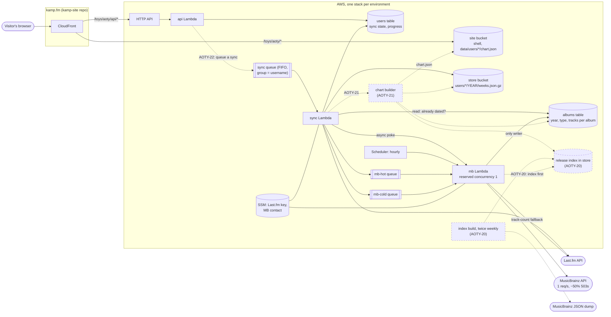
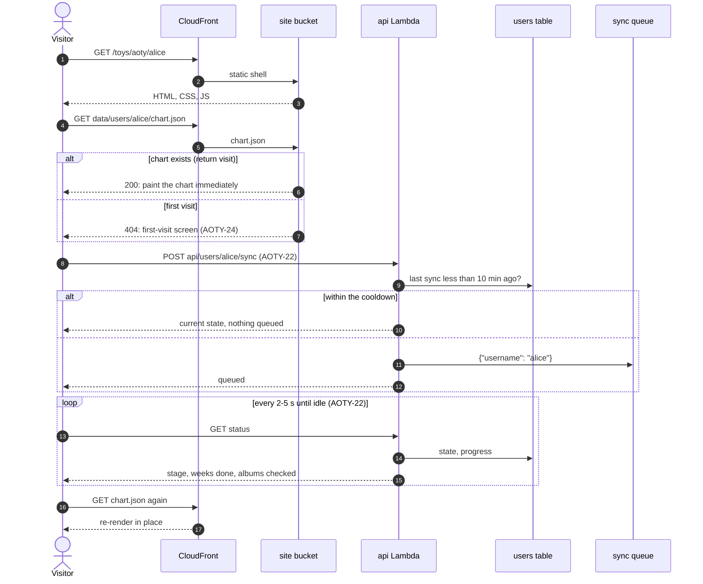
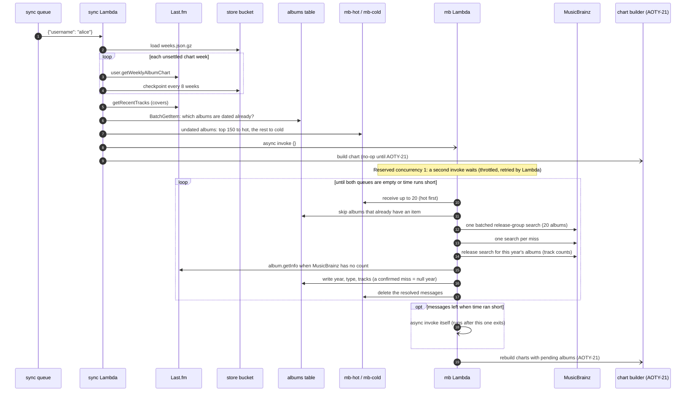
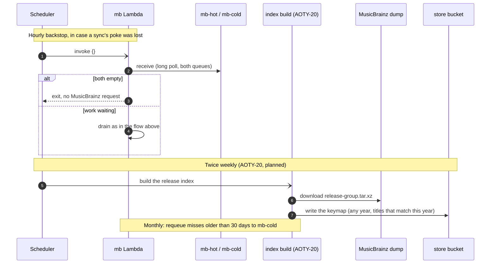

# M1 architecture

How the pieces of the single-user app (AOTY-2) fit together. Solid boxes are built; dashed
boxes and arrows are planned, labelled with the story that adds them. One copy of the stack
runs per environment (staging, prod, sandbox); names below drop the `kamp-aoty-<env>-` prefix.

Three actors drive everything:

- **Visitor**: a person opening `kamp.fm/toys/aoty/<username>`.
- **Sync worker**: reads one user's Last.fm history into the private store.
- **mb lane**: the one MusicBrainz client, which dates albums and counts their tracks.

The page never waits on MusicBrainz or Last.fm: it reads static JSON from CloudFront, and the
background work keeps that JSON fresh.

## Infrastructure

## Visitor flow

What a visit will look like once AOTY-21, 22 and 23 land. Today only `GET /api/health`
exists.

## Background flow: sync, then the mb lane

What happens after a sync message is queued. The sync worker and the mb lane are built (AOTY-18
and this story, AOTY-19); the chart builder hook is a no-op until AOTY-21.

A failed request is never written. Its message reappears after the visibility timeout, and
after 5 receives it moves to the dead-letter queue.

## Background flow: schedules

## Who reads and writes what

| Store | Written by | Read by |
|---|---|---|
| store bucket `users/*/YEAR/weeks.json.gz` | sync | chart builder (AOTY-21) |
| store bucket release index | index build (AOTY-20) | mb lane, chart builder |
| `albums` table | **mb lane only** | sync (what to queue), chart builder |
| `users` table | api, sync | api (status, cooldown) |
| site bucket `data/users/*/chart.json` | chart builder (AOTY-21) | browsers, through CloudFront |
| mb-hot / mb-cold | sync (AOTY-20: monthly re-check) | mb lane |

The lookup order for an album's year (AOTY-20) is the index, then the `albums` table, then a
live search in the mb lane. The lane writes the item whichever of those found the year, and
looks up the track count itself, because the dump has none. So "has an `albums` item" stays
the one test for "resolved".
