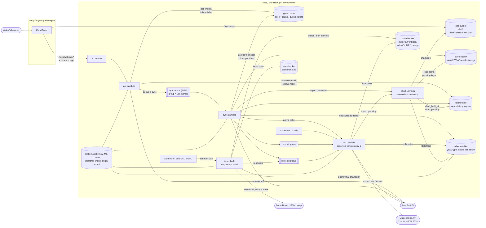
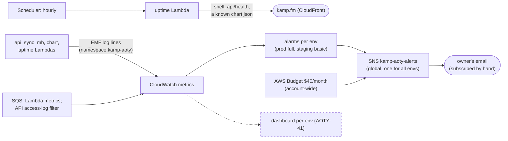
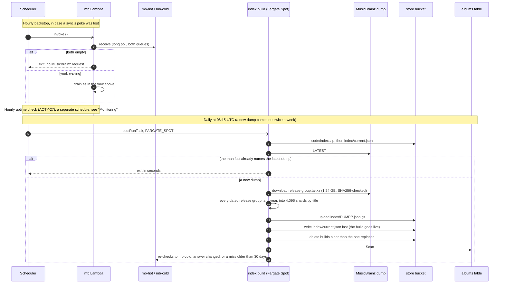
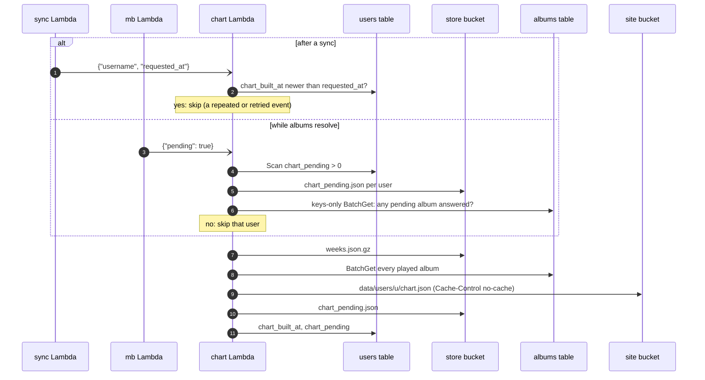

# M1 architecture

How the pieces of the single-user app (AOTY-2) fit together. Solid boxes are built; dashed
boxes and arrows are planned, labelled with the story that adds them. One copy of the stack
runs per environment (staging, prod, sandbox); names below drop the `kamp-aoty-<env>-` prefix.

Five actors drive everything:

- **Visitor**: a person opening `kamp.fm/toys/aoty/user/<username>`.
- **Sync worker**: reads one user's Last.fm history into the private store.
- **mb lane**: the one MusicBrainz client, which dates albums and counts their tracks. It asks
  the release index first.
- **Index build**: a daily Fargate Spot task that turns the MusicBrainz JSON dump into the
  release index, and queues re-checks for albums whose answer has changed.
- **Chart builder**: turns one user's store and the `albums` table into `chart.json` on the
  site bucket, after each sync and while that user's pending albums resolve (AOTY-21).

The page never waits on MusicBrainz or Last.fm: it reads static JSON from CloudFront, and the
background work keeps that JSON fresh.

## Infrastructure



The index build runs in the default VPC's public subnets with a public IP, with no NAT
gateway. CD uploads its code to `code/index.zip`, as it updates the Lambdas' code.

Guardrails (AOTY-26, `infra/README.md` "Guardrails"): the sync mapping's `maximum_concurrency`
(`sync_concurrency`, 2) caps sync spend and its Last.fm rate; SSM knobs pause new users or all
syncs and set the cooldown and limits without a deploy; the HTTP API throttles GET and POST
separately; and with `enforce_origin` the api refuses user routes that lack kamp.fm's
`x-kamp-origin` secret, so the `execute-api` URL can't bypass CloudFront.

## Monitoring (AOTY-27)



Each alarm's description links to its runbook entry in `infra/README.md`, "Alarms". The topic
and the budget are in `infra/global/` (applied by the admin), so no deploy role touches SNS or
Budgets, and sandbox's role (usable from any branch) can't write alarms at all.

## Visitor flow

A visit, as built (AOTY-21, 22, 24). `GET /api/health` reports the env and the deployed commit's
SHA, read from the zip's `build.json` (AOTY-35).

A first visit is a chart page with nothing ranked yet: no chart.json, or one whose By Track
ranking is empty. The first build runs before the mb lane has dated anything, so that empty
chart is the usual case. The page shows a dim wall of the user's recent covers (the status's
`wall`, from sync's `preview`) and the running stats (`so_far`). The banner carries a progress
line that only moves forward. The first chart that ranks something paints with its entrance
animation. It ends with a message when every album is checked and none is from the year, or
when the chart stops rebuilding or 10 minutes pass. `wall` is the user's public recent listening,
the same as their Last.fm profile shows, and goes once a chart ranks anything.

When syncs are backed up (AOTY-26), a new user's first visit shows the request line: "you're
caller #N" from the status's `queue.position` (only ever going down), the page's address with a
copy button, and `queue.wait_s` once 20 first syncs are timed. The tab title shows the place,
then the reading percent. The 10-minute watch starts only once the sync leaves the queue.

```mermaid
sequenceDiagram
  autonumber
  actor V as Visitor
  participant CF as CloudFront
  participant S3 as site bucket
  participant API as api Lambda
  participant U as users table
  participant Q as sync queue

  V->>CF: GET /toys/aoty/user/Alice
  CF->>S3: static shell (every page path serves index.html)
  S3-->>V: HTML, then hashed CSS and JS
  V->>CF: GET data/users/alice/chart.json (lowercased)
  CF->>S3: chart.json
  alt chart exists (return visit)
    S3-->>V: 200: paint the chart, URL rewritten to Last.fm's casing
  else first visit
    S3-->>V: 404, or a chart that ranks nothing: the first-visit view (AOTY-24)
  end
  V->>API: POST api/users/alice/sync (JSON only)
  API->>U: a sync running, or one requested within sync_cooldown_seconds (10 min)?
  alt yes
    API-->>V: 200, nothing queued, current status
  else a new name
    API->>API: paused? 503 paused. Past the IP's new names this hour? 429 too_many_new
    API->>API: user.getInfo (3 s); unknown: 404 + a not_found row with a 1-day TTL
  else
    API->>API: pause_syncs: 200 paused. A new user over max_queue_for_new: 503 busy
    API->>U: conditional: state=queued, sync_requested_at=now, queue_ticket
    API->>Q: {"username": "alice"} (a failed send undoes the mark: 503)
    API-->>V: 202, queued
  end
  loop every 2 s backing off to 5 s (20-25 s in line), paused while hidden, until idle
    V->>API: GET api/users/alice/status
    API->>U: state, progress, preview, sync_finished_at, chart_*
    API-->>V: stage (queued, reading, building, dating, idle, error), weeks, new plays, wall, so_far, queue
  end
  V->>CF: GET chart.json, once the chart builder has written a newer one
  CF-->>V: repaint in place (scroll, view and ranking kept)
```

## Background flow: sync, then the mb lane

What happens after a sync message is queued. The sync worker, the mb lane and the release
index and the chart builder are built (AOTY-18, 19, 20, 21).

```mermaid
sequenceDiagram
  autonumber
  participant Q as sync queue
  participant SW as sync Lambda
  participant LF as Last.fm
  participant ST as store bucket
  participant AT as albums table
  participant HQ as mb-hot / mb-cold
  participant MB as mb Lambda
  participant MBA as MusicBrainz
  participant CB as chart Lambda

  Q->>SW: {"username": "alice"}
  SW->>ST: load weeks.json.gz
  opt a first sync (AOTY-24)
    SW->>LF: getRecentTracks page 1, written to the users row as preview (the cover wall)
  end
  loop each unsettled chart week
    SW->>LF: user.getWeeklyAlbumChart
    Note over SW: progress (weeks, plays, running stats) to the users row after every week
    SW->>ST: checkpoint every 8 weeks
  end
  SW->>LF: getRecentTracks (covers; a first sync reuses page 1)
  SW->>AT: BatchGetItem: which albums are dated already?
  SW->>HQ: undated albums: top 150 to hot, the rest to cold
  SW-)MB: async invoke {}
  SW-)CB: {"username", "requested_at"}

  Note over MB: Reserved concurrency 1: a second invoke waits (throttled, retried by Lambda)
  MB->>ST: index/current.json (re-read at most hourly)
  loop until both queues are empty or time runs short
    MB->>HQ: receive up to 20 (hot first)
    MB->>AT: skip albums that already have an item (unless a message is a re-check)
    MB->>ST: index shards (cached while warm)
    Note over MB: A trusted hit (exact title, type Album) needs no year search
    MB->>MBA: one batched release-group search for the rest
    MB->>MBA: one search per miss
    MB->>MBA: release search for this year's albums (track counts; a re-check keeps the stored count)
    MB->>LF: album.getInfo when MusicBrainz has no count
    MB->>AT: write year, type, tracks (a confirmed miss = null year)
    MB->>HQ: delete the resolved messages
  end
  opt messages left when time ran short
    MB-)MB: async invoke itself (runs after this one exits)
  end
  MB-)CB: {"pending": true}: after the first batch that writes, then at most once a minute, and at the end
```

A failed request is never written. Its message reappears after the visibility timeout, and
after 5 receives it moves to the dead-letter queue.

## Background flow: schedules



A Spot interruption kills a build before its manifest is written, so the old index stays live
and the next day's run starts over.

## Who reads and writes what

| Store | Written by | Read by |
|---|---|---|
| store bucket `users/*/YEAR/weeks.json.gz` | sync | chart builder |
| store bucket `users/*/YEAR/chart_pending.json` | chart builder | chart builder (pending pass) |
| store bucket `index/current.json`, `index/DUMP/*.json.gz` | index build | mb lane |
| store bucket `code/index.zip` | CD | index build (at start) |
| `albums` table | **mb lane only** | sync (what to queue), index build (re-check scan), chart builder |
| `guard` table | api (`ip#` new-name sets, the `queue` item's `joined` and burnt `started`), sync (`started`, `first_syncs`, `first_sync_seconds`) | api (limit, queue position, wait) |
| `users` table | api (`queued`, `sync_requested_at`, `queue_ticket`, `not_found` rows with `expires_at`), sync (state, progress, `preview`, `sync_finished_at`, `display_name`; removes `queue_ticket`), chart builder (`chart_built_at`, `chart_pending`, `chart_plays`, `chart_albums`, `chart_hits`; removes `preview` once a chart ranks anything) | api (status, cooldown), chart builder |
| site bucket `data/users/*/chart.json` | chart builder | browsers, through CloudFront |
| site bucket `index.html`, `assets/*` | CD (`scripts/build_shell.py`) | browsers, through CloudFront |
| mb-hot / mb-cold | sync; index build (re-checks, mb-cold only) | mb lane |

An album's year comes from the `albums` table if it has an item. If not, the mb lane tries the
index, then a live search. The lane writes the item whichever of the two found the year, and
looks up the track count itself, because the dump has none. So "has an `albums` item" stays
the one test for "resolved". A re-check is the only way an item is rewritten. The index build
asks for one when its answer has changed, and the chart builder will read the table, so the
correction reaches every chart.

The index covers every dated release group of any year, not only the target year's, so the
same index serves 2027 and M4's albums of any year. An index answer is trusted only for an
exact title of type Album. The dump lags days behind MusicBrainz, so last year's single "X"
mustn't stand in for this year's album "X" that the dump doesn't have yet.

## Chart builder (AOTY-21)



Reserved concurrency 1 runs builds one at a time, so a build that read older data can't
overwrite a newer chart. The year comes from the `albums` table at build time, so a re-check
that corrects an album reaches the chart at the user's next sync. The pending pass Scans the
users table, which is fine at M1's scale; past a few thousand users, a sparse GSI on
`chart_pending` replaces it.
